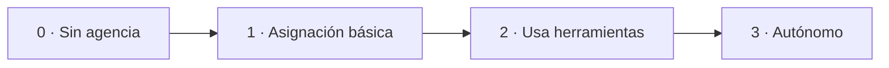
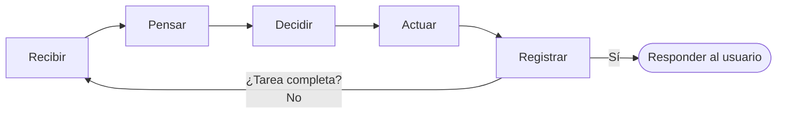
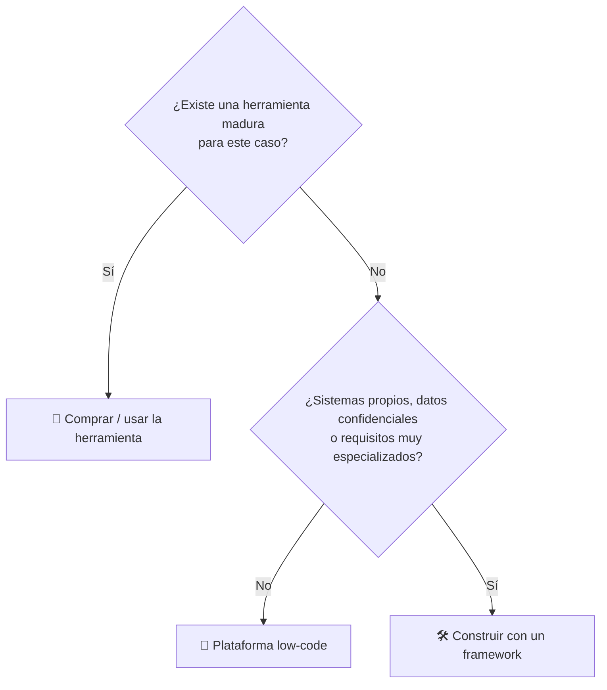

# Agentes-de-IA
Mejorar con confianza tus flujos de trabajo usando la tecnología adecuada; implementando potentes agentes donde se necesita inteligencia real y adaptación.

---

## Contenido

1. [¿Qué es un agente de IA?](#1-qué-es-un-agente-de-ia)
2. [Ejemplo: un agente de viajes](#2-ejemplo-un-agente-de-viajes)
3. [¿En qué se diferencia de automatizar con un prompt?](#3-en-qué-se-diferencia-de-automatizar-con-un-prompt)
4. [Niveles de agencia](#4-niveles-de-agencia)
5. [¿Qué hace que un agente sea un agente? La trinidad](#5-qué-hace-que-un-agente-sea-un-agente-la-trinidad)
6. [¿Cuándo adoptar un agente y cuándo no?](#6-cuándo-adoptar-un-agente-y-cuándo-no)
7. [El ecosistema: comprar o construir](#7-el-ecosistema-comprar-o-construir)
8. [Referencias](#referencias)

---

## 1. ¿Qué es un agente de IA?

> **Un agente de IA es un sistema que aprovecha un modelo de IA para interactuar con su entorno con el fin de alcanzar un objetivo definido por el usuario, combinando razonamiento, planificación y ejecución de acciones mediante herramientas externas.**

Una forma sencilla de recordarlo:

| Parte | Analogía | Qué aporta |
|---|---|---|
| **Modelo de IA** | 🧠 Cerebro | Entiende lo que se le pide, razona y decide el siguiente paso. |
| **Herramientas** | 🦾 Cuerpo | Todo lo que *puede hacer*: consultar una base de datos, buscar en la web, leer un calendario, reservar, enviar un correo. |
| **Entorno** | 🌍 Mundo real | Los sistemas y datos sobre los que actúa y de los que recibe respuesta. |

Sin herramientas, el modelo solo puede *hablar* de lo que sabe. Con herramientas, puede *actuar*.

---

## 2. Ejemplo: un agente de viajes

El usuario escribe en lenguaje natural:

> *"Quiero ir a algún lugar cálido en diciembre, del 20 al 27, con un presupuesto de 1.500 USD para dos personas."*

El agente cuenta con estas herramientas:

| Herramienta | Para qué sirve |
|---|---|
| `calendario` | Revisar la disponibilidad del usuario en esas fechas. |
| `buscar_vuelos` | Consultar vuelos y precios. |
| `buscar_alojamiento` | Consultar hoteles disponibles (p. ej., integración con un sitio de reservas). |
| `reservar` | Confirmar vuelo y hotel. |

Así razona y actúa, paso a paso:

| # | Piensa (modelo) | Actúa (herramienta) | Observa (resultado) |
|---|---|---|---|
| 1 | "Algún lugar cálido en diciembre" significa un destino tropical. Primero confirmo las fechas. | `calendario(20–27 dic)` | El usuario está libre. |
| 2 | Busco vuelos a destinos tropicales para dos personas. | `buscar_vuelos(...)` | Cartagena: 520 USD · Punta Cana: 780 USD · Cancún: 690 USD. |
| 3 | Cartagena deja más margen del presupuesto para el hotel. | `buscar_alojamiento(Cartagena, 7 noches)` | Hotel en el centro histórico: 840 USD. |
| 4 | 520 + 840 = 1.360 USD, dentro del presupuesto. Pido confirmación antes de pagar. | — | El usuario aprueba. |
| 5 | Reservo y termino. | `reservar(vuelo, hotel)` | Confirmaciones recibidas. ✅ Objetivo cumplido. |

Lo importante no es cada respuesta aislada, sino el **ciclo**: el agente interpreta, decide qué herramienta usar, mira el resultado y ajusta su plan hasta lograr el objetivo.

---

## 3. ¿En qué se diferencia de automatizar con un prompt?

| | Flujo automatizado con un prompt | Agente de IA |
|---|---|---|
| **Quién define los pasos** | Una persona, de antemano. El orden es fijo. | El modelo, en tiempo de ejecución, según lo que va encontrando. |
| **Ante un caso no previsto** | Se rompe o da una respuesta genérica. | Re-planifica: prueba otra herramienta u otro camino. |
| **Acceso al mundo** | Solo lo que el flujo le pasa como texto. | Usa herramientas para consultar y actuar. |
| **Memoria del proceso** | Cada llamada es independiente. | Lleva registro de lo que ya hizo y de lo que falta. |
| **Ejemplo** | "Resume este correo y guárdalo en una hoja". | "Resuelve el reclamo de este cliente". |

Un flujo con prompt **ejecuta** una receta; un agente **decide** la receta.

---

## 4. Niveles de agencia

La agencia no es "sí o no": es un espectro según cuánto puede decidir y hacer el sistema por sí solo.

| Nivel | Agencia | Qué puede hacer | Ejemplo |
|:---:|---|---|---|
| **0** | Sin agencia | Responde con lo aprendido en su entrenamiento o ejecuta tareas predefinidas. | Un chatbot sin herramientas; un flujo de automatización fijo. |
| **1** | Asignación básica | Clasifica o enruta situaciones dentro de un flujo ya diseñado. | En atención al cliente, el modelo lee un ticket y lo asigna al área correcta. |
| **2** | Usa herramientas | Llama a herramientas externas para consultar o actuar. | Un asistente de viajes que puede buscar y reservar vuelos. |
| **3** | Autónomo | Encadena varios pasos por sí mismo: planifica, ejecuta, evalúa y corrige. | Herramientas de investigación profunda que buscan, leen, contrastan fuentes y redactan un informe. |

> A mayor nivel, más capacidad… y también más necesidad de control, monitoreo y límites claros.

---

## 5. ¿Qué hace que un agente sea un agente? La trinidad

Un agente se sostiene sobre tres piezas:

### 🧠 Modelo — el razonamiento
- Convierte el mensaje del usuario en un **plan de acción paso a paso**.
- Entiende la intención aunque no sea literal: *"algún lugar cálido en diciembre"* → buscar destinos tropicales.

### 🦾 Herramientas — el puente con el mundo real
Son esenciales porque **cierran la brecha entre lo que el agente "sabe" y lo que puede hacer**. Sin ellas, el modelo no ve datos actuales ni puede cambiar nada.
- Integrarse con un sitio de reservas para buscar y reservar alojamiento.
- Sincronizarse con el calendario del usuario para verificar fechas.
- Consultar una base de datos de clientes, enviar un correo, crear un ticket.

### 🔁 Orquestación — el ciclo de decisión
Gestiona el ciclo de toma de decisiones del agente:

1. **Recibe** datos (el pedido del usuario o el resultado de una herramienta).
2. **Piensa** qué significan.
3. **Decide** qué hacer: usar otra herramienta, preguntar al usuario o terminar.
4. **Registra** todo lo que se ha hecho, para no repetir pasos y saber qué falta.

Este ciclo **continúa hasta que la tarea se completa**. La orquestación controla la secuencia de acciones y lo que viene después; por ejemplo, decide *cuándo* buscar vuelos o reservar hotel según el avance de la planificación.

---

## 6. ¿Cuándo adoptar un agente y cuándo no?

Imagina dos equipos de *call center*:

| | Call center A | Call center B |
|---|---|---|
| **Solicitudes típicas** | El ~80 % son variaciones de: *"¿Cómo hago seguimiento a mi pedido?"*, *"¿Cómo devuelvo un artículo?"*, *"¿Cómo cambio mi dirección postal?"* | Problemas enredados: *"Me cobraron dos veces, un pedido se canceló y el crédito en la tienda por una devolución anterior no se aplicó bien."* |
| **Tipo de decisión** | Sencilla, con respuestas comunes. | Compleja, depende del caso. |
| **Datos que necesita** | Ninguno o casi ninguno (no requiere acceso a la base de datos). | Historial del cliente, transacciones, notas, datos no estructurados. |
| **Reglas** | Claras y estables. | Difíciles de cumplir: hay excepciones y casos combinados. |
| **Atención** | Estandarizada. | Personalizada. |
| **Solución adecuada** | ✅ Un **chatbot sencillo** o preguntas frecuentes. | ✅ Un **agente** con acceso a la base de datos del cliente y herramientas para investigar y resolver. |

**Regla práctica:** si el problema se resuelve con un árbol de decisiones conocido, un agente es sobreingeniería. El agente se justifica cuando hay **contexto que consultar, pasos que no se pueden prever y decisiones que dependen de cada caso**.

---

## 7. El ecosistema: comprar o construir

El ecosistema de agentes es muy variado y cambia cada día. A grandes rasgos hay tres caminos, de menor a mayor complejidad:

| | 🛒 Herramientas listas para usar | 🧩 Plataformas *low-code / no-code* | 🛠️ Frameworks de agentes (construir) |
|---|---|---|---|
| **Ejemplos** | Asistentes de código con IA | n8n, Zapier | LangGraph, CrewAI |
| **Elígelo cuando…** | El caso de uso es de un dominio específico (p. ej., programación asistida). | Necesitas personalizar, pero no control total. | El caso de uso involucra sistemas propios. |
| | Ya existe una solución madura y probada en el mercado. | Los flujos son moderadamente complejos, pero siguen patrones comunes. | Se manejan datos confidenciales. |
| | Quieres reducir al mínimo el mantenimiento. | Quieres que los usuarios modifiquen el agente sin ayuda de ingeniería. | El agente es clave para la ventaja competitiva. |
| | | Necesitas integrarte rápido con los sistemas existentes. | Ninguna solución existente cumple los requisitos especializados. |
| **Complejidad** | Baja | Media | Alta: se construye desde cero |

---

## Referencias

- DataCamp — curso *Introducción a los agentes de IA* (base de estas notas).
- Wiesinger, J., Marlow, P. y Vuskovic, V. (s. f.). *Agents* (whitepaper de Google).

> Notas personales de estudio: el contenido está redactado con mis propias palabras y ejemplos.
